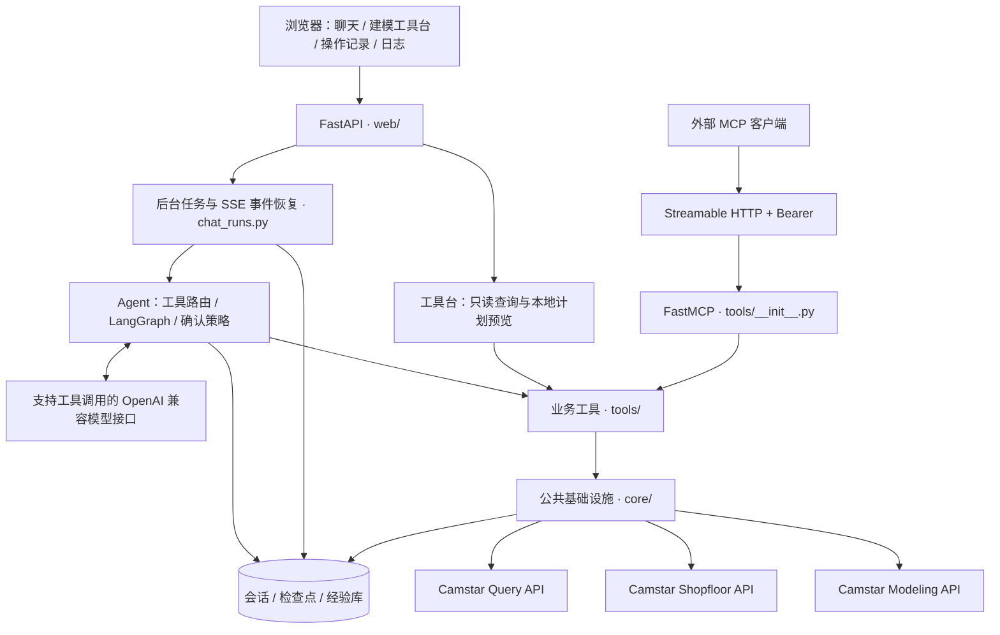

# Camstar Modeling MCP Agent

面向 Siemens Opcenter（Camstar）MES 的自然语言助手与 MCP 工具服务。项目以 Modeling、Shopfloor 和 Query API 为基础，覆盖主数据建模、工艺查询、容器生产执行、数据采集、物料与设备、质量管理和历史追溯。

项目提供两个主要入口：内置 Web 工作台通过 LLM 编排业务工具；外部 MCP 客户端通过 Streamable HTTP 调用同一组工具。默认执行引擎为 LangGraph，支持检查点、执行前确认、后台任务与断线后的进度恢复。

**能力范围以当前注册工具、现场 API 契约及对应验收记录为准。** 工具已实现、离线测试通过和真实 MES 业务验收是不同状态；本文不将其合并为“全部可用”。

## 功能特性

以下根据实际调用 `get_capabilities()` 及各分组返回的工具说明、限制和能力缺口整理，覆盖当前 14 个非空分组（含系统与能力发现）。目录来自本次独立进程加载的当前源码注册表，不代表既有 Web 进程已经加载相同版本，也不执行 MES 健康检查。

### 生产执行与工单管理

| 业务功能 | 现在可以做什么 | 范围与限制 |
| --- | --- | --- |
| 工单维护与开工检查 | 创建、查询、修改和删除工单；检查产品工艺、设备资源、物料、采集要求，可附带前后置任务和作业文档检查 | 配置检查会列出缺失和未知项；独立“工单下发”事务尚未核实，修改工单状态不能当作下发 |
| 容器开工与编号 | 按工单、固定产品版本、数量和层级启动容器；使用显式序列号或核实后的上下文自动编号规则 | Owner、开工原因和自动编号需按实际 Start 上下文校验；不包含开工后自动打印标签 |
| 进出站与加工量上报 | 按实际路线进站，支持分次上报加工量、核对剩余量、出站及移入生产完成节点 | 基础容器的 MoveIn → 独立 Thruput → 独立 MoveStd 已完成限定现场验收；原生复合 MoveOut 仍有服务端错误，不自动换事务重试 |
| 良品、不良与工单进度 | 区分不良登记保留在制和报废扣量；关联已核实事务登记良品/不良；查询工单在制、工序分布、原生完工量及完成日期 | 声明的良品/不良保存在应用台账；多工序吞吐不相加作为工单产量。MES 生产完成后的应用收尾不等于关闭 MES 工单 |
| 人工工时与生产历时 | 登记员工实际分钟，通过专用采集定义落 MES；从原生进出站历史计算经过时间，分别查询两种口径 | 限定流程已验收；人工分钟与自动历时分别统计，不相加，也不猜测 TaskTime 单位 |
| 工单过程任务 | 查询前后置任务、前置阻塞和历史；预览通过/失败结果，保存计划并单次提交 | 受限执行已接入，任务状态映射及非空现场执行仍待验收；不明结果保留整个工单占用 |

主要能力入口：`check_mfgorder_readiness`、`container_start`、`prepare_production_station_transition`、`prepare_container_throughput`、`get_mfgorder_production_summary`、`get_production_worktime`。详见[生产过站与报工](docs/production-reporting.md)、[工单任务](docs/mfgorder-task-development.md)。

### 建模、物料、设备与采集

| 业务功能 | 现在可以做什么 | 范围与限制 |
| --- | --- | --- |
| 产品与工艺配置 | 维护 Spec、Operation、Workflow 和 Product；查看产品完整工艺链、路线步骤、普通/返工路径、子流程和关联配置；检查引用完整性、比较版本 | 普通字段使用实例 ID 和最小 PUT 更新；部分集合 PATCH 兼容入口已禁用。条件表达式可读取，不执行求值 |
| 路线工具台与表格导入 | 可视化路线、比较版本；从已有线性路线生成新路线模板；解析 Excel/CSV、映射字段、校验全部行，预览后执行保存的导入计划 | 模板和导入限定线性路线；分支、子流程、返工及复杂调度配置会阻止复制/覆盖，不是全部主数据的通用导入 |
| 基础资料 | 维护产线、产品类型和容器层级；查询层级完整字段及编号规则；新建和修改计量单位，查询生产原因码 | 层级复杂配置仍需现场核实；无 UOM 删除及单位换算闭环，原因码可查询不代表全部可维护 |
| BOM 维护与产品绑定 | 创建 BOM，修改基本信息，增删改和重命名明细，配置数量、单位及发料控制；显式复制升版并保留旧版；固定版本关联、换绑或解绑产品 | 标准 BOM 已完成限定现场验收；不支持整 BOM 删除、ResourceBOM、幻影 BOM 和替代料表维护；发料控制可建模不代表对应投料模式均可执行 |
| 用料需求与投料 | 查询产品/BOM 需求、已投量、净剩余和历史；模式 5 按本次增量投料/补投；模式 2 从一个来源容器扣减并投料 | 模式 2 限首次完整需求；模式 1/3/4 仅意图预览，替代料及第二数量未形成执行闭环；退料、替换和分配物料未接入 |
| 设备主数据与生产事务 | 创建设备和修改主数据；启停明确的维护要求；执行设置、状态模型 Up/Down 转换、主副数量吞吐及普通设备采集；查询实际状态和历史 | 五项核心能力已完成限定现场验收；日期维护要求启停已验收，周期/吞吐触发规则待验收。分组设备采集执行门禁关闭，维修保养任务闭环未接入 |
| 数据采集配置与执行 | 维护普通/分组采集定义、点、类型、单位、限值和采样数；升版/删除定义，绑定或解绑指定 Spec；校验普通值和分组样本、提交单次计划并核对历史 | 采集配置维护及完整提交链仍有非空现场验收待补；生产人工工时落账有独立验收，不能据此推断全部采集类型已验收 |
| 作业文档 | 查询 Spec 关联文档和文档集，并按受限路径下载正式文件 | 文档/文档集维护及现场附件上传、挂接/移除尚未接入 |

主要能力入口：`get_product_process`、`get_workflow_structure`、`preview_workflow_import`、`prepare_bom_change`、`prepare_component_issue`、`prepare_resource_setup`、`prepare_data_collection_definition`。详见[建模工具台](docs/modeling-workbench.md)、[BOM 维护](docs/bom-maintenance.md)、[设备维护](docs/resource-maintenance.md)、[采集工具链](docs/collection-workflow-tools.md)。

### 质量、抽样检验与 SPC

| 业务功能 | 现在可以做什么 | 范围与限制 |
| --- | --- | --- |
| NCR、CAPA 与质量事件 | 查询质量对象和历史；准备 NCR 创建/更新/关闭及升级事件，CAPA 草稿/提交/关闭；受限事件创建、草稿补齐、正式提交、文字和标准扩展资料修改、日志追加、开启、分派与关闭 | 各入口按对象、组织、状态和签名要求限制执行；既有草稿分类修改、任意自定义 EventData、复杂检查表及通用生命周期未完整开放，不能概括为完整 QMS |
| 审批、角色替代与单次委托 | 查询模板、审批表、条目、允许决策和周期历史；挂表路由、批准/拒绝、受限取消及修订重提；原生授权下角色替代；指定审批人将一个条目委托给明确新员工 | 角色/身份和原生权限必须核实；单次委托及多类审批现场验收待补。日期自动委托、连续转委托、批量转派和撤销委托未开放 |
| 电子签名 | 在受支持的直接 Event/CAPA 审批中，由实际当前员工通过独立本机页面输入单人质量签名口令 | 受限链路已实现，真实 MES 签名验收待补；通用多签/协签受原生认证契约限制，执行门禁关闭，普通确认不能替代签名 |
| 检验与抽样配置 | 创建、更新、升版检验点、检验项目和抽样计划；绑定固定产品版本；查询抽样表、当前频率、计数器和检验水平并准备受限维护 | 不自动回填已有容器任务；当前采样状态不用于推算下一容器必检/免检；配置维护本身仍有现场验收待补 |
| 单容器和批检验 | 准备计数/测量检验，读取任务和历史；管理抽样批、批检验及完成计划；显式选择已有规则下的全检/自动扣量分支 | 计数按样本/不良扣量、跨次及分组累计、单组多原因扣量和归零关闭已有现场验收；全检转换、测量组合和批自动处置不属于该验收。失败检验关联事件的正向验收仍受 MES 创建服务权限阻塞 |
| 数量损失与批处置 | 基础单/双单位损失；同产品、同主单位、同步骤的父子树及跟踪载具损失；准备整批返工；对符合条件的失败抽样批执行一次原生整批报废并核实父子历史 | 父子/载具损失及多成员整批报废已完成限定现场验收；真实 Batch 的 ChangeQty 被 MES 禁止，父容器部分分摊未开放；整批返工的路由及最终历史仍有待验收项 |
| 原始趋势与本地 SPC | 从 MES 原始采集历史读取参数趋势；本地计算 I-MR、Xbar-R 和 p/np/c/u 图，按对应基线/控制配置分析信号并显示聊天图表；诊断原生 SPC 配置，准备受限注释/违例计划及独立测试模型 | 原始趋势不判异；本地分析不等于原生引擎结果。原生计算链、有效控制限、正式登记和自动处置尚未完成闭环；注释准备仍会被缺少签名回显拦截，测试模型及显示设置不等于原生已出图 |

主要能力入口：`prepare_nonconformance_report`、`prepare_quality_approval_decision`、`prepare_quality_approval_delegation`、`prepare_container_inspection`、`prepare_related_container_quantity_loss`、`prepare_sampling_lot_scrap`、`get_spc_parameter_trend`、`analyze_spc_history`。详见[质量完成清单](docs/quality-completion-plan.md)、[数量损失](docs/quantity-loss-complex.md)、[批报废](docs/lot-scrap-completion.md)、[SPC 状态](docs/c6-completion-status.md)。

### 查询、追溯与使用支持

| 功能 | 现在可以做什么 | 范围与限制 |
| --- | --- | --- |
| 跨对象查询与汇总 | 查询工单、容器、产品、工艺及历史；用已审核工具编排依赖、分页、关联与精确汇总；工单日期模板区分计划开工、原生生产开工及实际首箱开工 | 分页不完整时不输出完整汇总；元数据可缓存，生产结果不作为元数据缓存；跨查询不保证事务快照 |
| 通用 MES 查询 | 发现 Query 服务和参数，执行标准 Inquiry、Advanced Query、User Query 和受限单条只读 SELECT | 自定义 Inquiry 事件按实际效果纳入安全策略；通用查询不能绕过专用生产工具执行写入 |
| 容器追溯与拆合 | 查询状态、直接历史、父子/谱系及跨对象追溯；预览和单次执行受限拆分、合并、装箱/拆箱计划 | 复杂多层装箱、跨产品/工序/单位合批和复杂双数量未通用开放；多个拆合入口现场验收待补 |
| 后台聊天与记录恢复 | 流式查看回复和工具进度；多用户名称下组织多个会话；切页、刷新、返回原聊天时恢复后台输出、确认卡和记录 | 服务进程存活时后台执行继续；主动停止不回滚，重启不自动重放事务；用户名分组不等于独立登录认证 |
| 受控执行与经验复用 | 按策略预览和确认原计划，单次提交后核实历史；失败经验脱敏进入候选库，人工审核后用于相关任务；查看推理和工具耗时 | 确认取决于当前会话设置及执行策略，不是每个写操作均逐项确认；不明结果不自动重试或解锁 |
| Web 与外部 MCP 接入 | Web 工作台使用配置的 OpenAI 兼容模型；外部客户端通过带 Bearer 鉴权的 Streamable HTTP 调用同一工具集，查询目录、参数和服务状态 | 模型须支持项目使用的工具调用和流式协议；MCP 直接调用不经过 Web Agent 确认节点，客户端须落实授权 |

能力目录会随工具注册及限制更新。使用 `get_capabilities()` 查看概览，`get_capabilities(group="material")` 查看领域工具，或 `get_capabilities(tool_name="prepare_bom_change")` 查看完整参数和该工具的具体限制。`load_tool_group` 只补充 Web Agent 下一轮可见定义，不执行业务，也不授予写入权限。

## 整体架构



| 层次 | 主要职责 | 关键入口 |
| --- | --- | --- |
| 应用与配置 | 创建应用、管理生命周期、读取 `.env`、启动服务 | `main.py`、`config.py`、`web/app.py` |
| Web 与后台任务 | 页面、会话、上传、任务排队、取消、事件持久化和 SSE 重连 | `web/routes.py`、`web/chat_runs.py`、`web/workbench.py` |
| Agent | 模型调用、领域工具筛选、上下文预算、状态图、执行确认、记忆和经验注入 | `agent/llm_client.py`、`agent/tool_routing.py`、`agent/langgraph_runtime.py` |
| 业务工具 | 将 MES 查询、维护和事务封装为 MCP 工具；处理各领域的预检、计划、执行及结果核实 | `tools/__init__.py`、各业务模块 |
| 公共基础设施 | MES 认证与 HTTP 连接、工具策略目录、响应整理、查询编排、锁、签名通道和日志 | `core/http_client.py`、`core/tool_catalog.py`、`core/read_plan.py` |
| 持久化 | JSON 会话、SQLite 检查点/任务/业务计划/审计、JSONL 性能日志 | `data/`，部分路径可通过环境变量配置 |

聊天请求先进入后台任务，再由 Agent 按当前问题选择工具。LangGraph 在模型规划、策略检查和工具执行之间循环；需要确认时保存原调用及参数并暂停，收到明确确认后从检查点继续。工具层负责访问 MES，结果再流式返回并保存到会话。

外部 MCP 请求直接进入工具层，不经过 Web Agent 的 LangGraph 确认节点。工具内部的参数校验、计划校验和防重复机制仍按各工具实现生效；外部客户端需自行落实用户授权和失败停止要求。浏览器 SSE 用于聊天输出，MCP 使用独立的 Streamable HTTP 协议端点。

## 目录结构

```text
CamstarModelingMCP/
├── main.py                 # Web 启动入口，默认 8030
├── config.py               # 统一环境变量配置
├── .env.example            # 配置模板
├── requirements.txt        # 运行依赖
├── requirements-dev.txt    # 测试依赖
├── agent/                  # 模型编排、LangGraph、路由、记忆与经验审核
├── core/                   # HTTP、策略、只读编排、锁、签名与监控
├── tools/                  # MCP 注册与各业务领域工具
├── web/                    # FastAPI、后台聊天任务、工具台、MCP 传输
├── static/                 # 原生 HTML/CSS/JS、图表 Worker、本地前端库
├── Swagger/                # 归档的 API 定义及扩展契约
├── docs/                   # 专题说明、设计、验收范围与开发状态
├── tests/                  # Python 回归、契约 fixture 与 JavaScript 测试
├── scripts/                # 离线守卫、诊断、评测与现场验收脚本
└── data/                   # 运行数据，按需生成，不提交到 Git
```

后端主要使用 FastAPI、FastMCP、LangGraph、httpx、SQLite 和 OpenAI SDK；表格处理使用 pandas/openpyxl。前端为静态页面与原生 JavaScript，图表使用本地 ECharts 和独立 Worker，无需单独执行前端构建。依赖版本以 `requirements.txt` 为准。

## 快速开始

### 1. 准备环境

需要可访问的 Camstar API、具备相应业务权限的 MES 账号，以及支持工具调用和流式响应的 OpenAI 兼容模型服务。当前本地开发环境使用 Python 3.13。

在项目根目录执行以下 PowerShell 命令：

```powershell
python -m venv venv
.\venv\Scripts\python.exe -m pip install -r requirements.txt
```

### 2. 配置连接

首次配置时复制模板；已有 `.env` 时直接编辑原文件，保留现有配置。

```powershell
Copy-Item .env.example .env
```

至少填写：

```dotenv
CAMSTAR_BASE_URL=https://your-camstar-host/Modeling
CAMSTAR_SHOPFLOOR_BASE_URL=https://your-camstar-host/Shopfloor
CAMSTAR_QUERY_BASE_URL=https://your-camstar-host/Query
CAMSTAR_USERNAME=your-username
CAMSTAR_PASSWORD=your-password

LLM_API_KEY=your-api-key
LLM_BASE_URL=https://api.deepseek.com/v1
LLM_MODEL=deepseek-chat

AGENT_ENGINE=langgraph
ENABLE_MCP_HTTP=False
```

未设置 Shopfloor/Query 地址时，程序会从 Modeling 地址推导同级服务路径。模型服务通过 `LLM_BASE_URL`、`LLM_MODEL` 和 `LLM_API_KEY` 配置，实际工具调用及流式协议兼容性需在所选服务上验证。

### 3. 启动 Web 服务

```powershell
.\venv\Scripts\python.exe main.py
```

| 入口 | 默认地址 |
| --- | --- |
| 聊天工作台 | [http://127.0.0.1:8030/](http://127.0.0.1:8030/) |
| 操作记录 | [http://127.0.0.1:8030/records](http://127.0.0.1:8030/records) |
| 建模工具台 | [http://127.0.0.1:8030/modeling](http://127.0.0.1:8030/modeling) |
| 性能日志 | [http://127.0.0.1:8030/logs](http://127.0.0.1:8030/logs) |
| MCP 端点 | [http://127.0.0.1:8030/mcp/](http://127.0.0.1:8030/mcp/)（需启用） |

可先用只读问题检查连接，例如“列出当前支持的功能”“查询工单 MO001 的产品、在制容器和工序分布”或“检查路线 WF001/A 的引用和路径完整性”。示例名称需替换为现场实际对象。

`main.py` 默认监听 `0.0.0.0:8030`。必须从项目根目录启动，以便正确解析静态资源和运行数据路径；修改源码或环境变量后需重启进程，页面资源更新后需刷新浏览器。

## 外部 MCP 接入

在 `.env` 中显式启用端点并设置独立访问令牌：

```dotenv
ENABLE_MCP_HTTP=True
MCP_HTTP_PATH=/mcp
MCP_API_KEY=replace-with-a-long-random-secret
MCP_ALLOWED_HOSTS=localhost:*,127.0.0.1:*,[::1]:*
MCP_ALLOWED_ORIGINS=
```

启用后未配置 `MCP_API_KEY` 会拒绝启动。`MCP_API_KEY` 用于客户端访问本服务，与用于访问 MES 的 `CAMSTAR_USERNAME` / `CAMSTAR_PASSWORD` 分开配置。

客户端连接参数如下，外层配置格式按客户端要求填写：

```json
{
  "url": "http://127.0.0.1:8030/mcp/",
  "headers": {
    "Authorization": "Bearer <MCP_API_KEY>"
  }
}
```

局域网访问需将实际服务主机名或 IP 加入 `MCP_ALLOWED_HOSTS`；浏览器型 MCP 客户端按需配置 `MCP_ALLOWED_ORIGINS`。新增工具后需重启服务并刷新客户端工具目录。

## 执行、确认与恢复

- **工具策略显式登记**：`core/tool_catalog.py` 记录工具领域、读写类型、可见性和强制确认规则。启动注册时检查策略及可执行入口；按需筛选只影响模型可见工具，不是权限控制。
- **确认绑定原参数**：LangGraph 保存待执行调用，确认绑定工具、顺序和参数摘要。更换参数或生成新计划后重新判断确认要求；普通确认不能代替 MES 原生权限或电子签名。
- **批量与高影响操作分开判断**：默认创建阈值为 20、更新阈值为 3、删除阈值为 0（任意删除需确认）。创建保留任务累计上限，普通修改按本次待执行范围判断；业务强制确认规则独立生效，部分删除入口另有一次性 OTP 守卫。
- **计划与执行分离**：投料、采集、导入、质量等计划型工具先生成本地计划，再按各领域规则校验环境、摘要、时效和现场状态并执行。预览、计划 ID 或 HTTP 成功均不能单独证明业务完成。
- **不明结果保留待核实状态**：写入失败或超时不自动重试；`in_flight` / `unknown` 按原计划取证、对账或人工审计。应用内锁不能提供 MES 全局排他，多个 MES 请求也不组成跨步骤原子事务。
- **后台运行与页面连接分离**：切换聊天、刷新或关闭浏览器后，只要服务进程仍运行，已接受任务可继续；返回原聊天按事件序号恢复。显式停止不会回滚已提交操作，服务重启也不会自动重放遗留事务。
- **签名口令独立输入**：受支持的质量签名使用独立本机页面和短期内存输入，口令不进入聊天或 MCP 参数。当前签名输入要求浏览器与 Web 服务位于同一台机器，具体范围见[签名说明](docs/quality-electronic-signature.md)。

后台任务状态、接口和恢复边界见[后台聊天任务](docs/background-chat-runs.md)；移动失败后的限制见[容器移动与恢复](docs/container-movement-recovery.md)。

## 配置与运行数据

完整模板见 [.env.example](.env.example)，程序默认值见 [config.py](config.py)。下表列出常用项；模板可以覆盖程序默认值，例如 `MAX_TOOL_LOOPS` 在代码中默认 15，模板设为 30。

| 配置 | 程序默认值 / 用途 |
| --- | --- |
| `CAMSTAR_TIMEOUT` / `LLM_TIMEOUT` | MES 请求 30 秒 / 模型请求 45 秒 |
| `CAMSTAR_TRUST_ENV` | `True`；是否沿用系统代理环境，内网直连可明确设为 `False` |
| `AGENT_ENGINE` | `langgraph`；`legacy` 保留为回退路径，执行确认能力有差异 |
| `MAX_TOOL_LOOPS` / `LANGGRAPH_RECURSION_LIMIT` | 默认 15 轮；状态图步数默认按 `MAX_TOOL_LOOPS * 6 + 10` 计算 |
| `READ_QUERY_CONCURRENCY` / `MAX_READ_FAILURES` | 只读并发上限默认 4；连续读取失败上限默认 3 |
| `SAFE_CREATE_THRESHOLD` / `SAFE_UPDATE_THRESHOLD` / `SAFE_DELETE_THRESHOLD` | 默认 `20` / `3` / `0` |
| `CHAT_MAX_RUNNING` / `CHAT_MAX_RUNNING_PER_USER` | 单进程同时运行任务默认 4 / 每用户 2 |
| `CHAT_MAX_QUEUED` / `CHAT_MAX_QUEUED_PER_USER` / `CHAT_QUEUE_TIMEOUT` | 默认排队 32 / 每用户 8 / 等待 120 秒 |
| `AGENT_HISTORY_TOKEN_BUDGET` | `0`；关闭应用侧历史预算裁剪，正数显式启用本地估算预算 |
| `UPLOAD_MAX_BYTES` / `EXCEL_MAX_SHEETS` | 通用上传默认 20 MiB / 20 个工作表；具体工具可有更严格限制 |
| `ENABLE_CHAT_CHARTS` / `ENABLE_PERFORMANCE_LOG` | 均默认 `True` |
| `PERF_RETENTION_DAYS` / `CHAT_EVENT_RETENTION_DAYS` / `UPLOAD_RETENTION_DAYS` | 性能日志 90 天 / 聊天事件 30 天 / 上传文件 7 天；`0` 禁用对应清理 |

运行数据主要包括：

| 数据 | 默认位置 |
| --- | --- |
| 用户会话历史 | `data/sessions/` |
| LangGraph 检查点 | `data/langgraph_checkpoints.sqlite`（`LANGGRAPH_CHECKPOINT_DB`） |
| 后台任务及事件 | `data/chat_runs.sqlite`（`CHAT_RUN_DB`） |
| 经验候选与审核结果 | `data/agent_experience.sqlite`（`EXPERIENCE_DB`） |
| 图表快照 | `data/chat_charts.sqlite3`（`CHAT_CHART_DB`） |
| 性能日志 | `data/logs/performance.jsonl` |
| 业务计划、尝试记录和台账 | `data/` 下各领域 SQLite 数据库及相关锁文件 |

当前后台任务调度采用**单 Web worker**，不支持多 worker/多实例共享运行任务。备份和迁移应一并保留配置、会话、检查点、业务计划、尝试记录及锁；不要通过删除事务库或占用记录解决 `unknown`。日志清理不会自动删除业务计划、检查点和会话历史。

Web 会话按 `username` 组织，当前没有独立登录认证体系；外部 MCP 的 Bearer 鉴权不覆盖普通 Web 路由。对外部署需配置访问控制和 HTTPS。普通 MES HTTP 客户端当前使用 `verify=False`，签名专用通道强制校验证书，两条通道的 TLS 行为不同。

### 经验与记忆

工具失败会脱敏、去重并进入经验候选库，经人工审核后才在相关任务中注入；候选不会自动改写 Agent 行为。

```powershell
.\venv\Scripts\python.exe -m agent.experience list
.\venv\Scripts\python.exe -m agent.experience list --status all
```

审核命令、撤销、过期、替代及契约版本迁移见[学习与记忆生命周期](docs/learning-and-memory.md)。Container Start 还会读取项目内的 Start contract 和已知失败资料。修改业务契约后应同步核对 `MEMORY_CONTRACT_VERSION` 及已审核经验的适用性。

## 开发与验证

安装开发依赖并使用 HTTPX 离线守卫运行 Python 回归：

```powershell
.\venv\Scripts\python.exe -m pip install -r requirements-dev.txt
.\venv\Scripts\python.exe -m pytest -p scripts.offline_test_guard tests
```

守卫阻止当前测试进程中的真实 HTTPX 网络传输，允许显式 Mock 和 ASGI 测试；它不等于操作系统级网络隔离。部分契约及现场回放用例需要未纳入 Git 的本地归档，干净检出下可能跳过。JavaScript 测试和浏览器验收需另行准备 Node.js、Playwright 及对应浏览器，具体要求见专题文档。`scripts/` 同时包含真实 MES 验收脚本，执行前需核对目标环境、对象和写入范围。

新增工具通常需要：

1. 在 `tools/` 实现业务工具，并通过 `tools/__init__.py` 导入注册。
2. 在 `core/tool_catalog.py` 登记策略，确保 `get_tool_func` 可解析；按需补充 `agent/tool_routing.py` 和能力限制说明。
3. 对写入明确预检、确认、单次尝试、结果核实及不明结果恢复；复用所属领域计划与占用机制。
4. 增加相应回归和契约证据，更新专题文档；现场未验收项单独记录。

## 当前边界与文档导航

- **生产流程**：基础容器的分步进出站、吞吐、两种不良处置、人工分钟落 MES 和整单生产完成已有独立现场验收；原生复合 `MoveOut` 仍有服务端错误。已验收流程明确使用 MoveIn、独立 Thruput、独立 MoveStd，各步骤独立提交。见[生产验收](docs/production-acceptance.md)。
- **质量闭环**：部分检验、损失、批返工和报废已有受限现场证据；审批、电子签名、事件及复杂组合仍有契约、权限或现场验收缺口。见[质量总清单](docs/quality-completion-plan.md)，不以历史工具数量或离线测试数量推断业务完成。
- **SPC 原生链路**：原始参数趋势、本地分析和聊天出图已有真实端到端验证；原生引擎、编译规则、有效控制限、结果适配和自动处置尚未形成完整现场闭环。测试建模和显示字段保存不能证明原生控制图可运行。见[SPC 收尾状态](docs/c6-completion-status.md)。
- **导入与查询**：路线导入限定线性路线，预览后执行，复杂配置有阻断条件；只读编排限定已审核工具与数据集，分页不完整时不生成完整汇总，跨查询不保证事务快照。见[导入计划](docs/import-plans-and-order-progress.md)、[只读编排](docs/read-orchestration.md)。

| 阅读目的 | 文档 |
| --- | --- |
| 查看当前能力缺口与周边开发状态 | [能力缺口](docs/core-capability-gaps.md)、[周边能力进度](docs/core-surrounding-capabilities-roadmap.md) |
| 理解工具目录、按需加载与生效边界 | [工具加载](docs/tool-loading-and-details.md)、[能力刷新](docs/capability-refresh.md) |
| 排查延迟、查询和图表响应 | [响应性能](docs/response-performance-round.md)、[查询与追溯性能](docs/trace-and-query-performance.md)、[聊天图表](docs/chat-charts.md) |
| 查看发布核对与质量验收入口 | [发布验收记录](docs/c8-release-acceptance.md)、[质量完成清单](docs/quality-completion-plan.md) |
| 查看真实模型多轮评测 | [多轮调用评测](docs/multiturn-evaluation/README.md) |
| 了解早期设计与执行流程 | [初版设计](docs/DESIGN.md)、[MCP 执行流程](docs/mcp_execution_flow.md)；历史文档中的版本、数量和状态需与当前源码及专题更新核对 |
